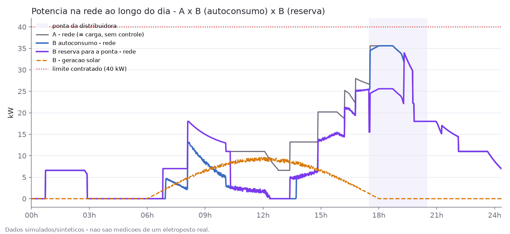
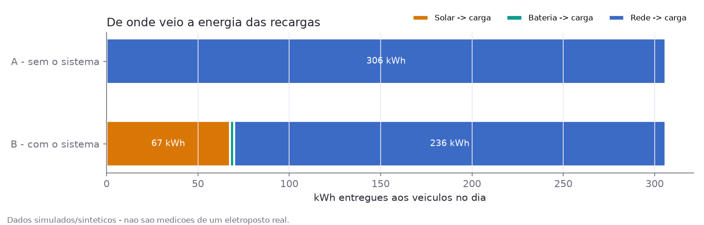
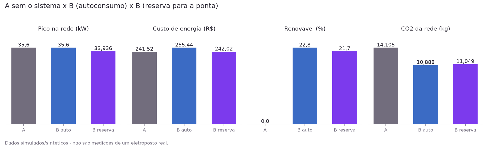

# ChargeGrid Intelligence
### Sprint 4 — Solução Final Integrada: eletroposto com solar, bateria e gestão inteligente de energia
**Disciplina: Soluções em Energias Renováveis e Sustentáveis (SERS) | FIAP x GoodWe | Grupo GTLF**

---

## 1. Equipe

| Nome | RM |
|---|---|
| Fernando Hideki Rosa Oda | RM 571408 |
| Léo Moreno Sambo | RM 569556 |
| Thor Ferreira Camargo | RM 569543 |
| Gabriel Botelho Romão | RM 570589 |
| Rafael Marinucci Peres | RM 569729 |
| David dos Reis Cardoso | RM 568938 |

---

## 2. Vídeo

**▶ [link do vídeo — a inserir]** *(vídeo não listado)*

---

## 3. Evolução do projeto

| Sprint | Entrega |
|---|---|
| **Sprint 1** | Proposta conceitual: problema, 4 pilares e arquitetura em 3 camadas |
| **Sprint 2** | Prova de conceito em terminal (`chargegrid_simulation.py`): sessões, controle de demanda e tarifação simulados |
| **Sprint 3** | Protótipo funcional: backend + dois portais web + microsserviço de IA, de ponta a ponta ([sers-sprint3.md](sers-sprint3.md)) |
| **Sprint 4** | Solução final integrada: **geração solar + bateria GoodWe** no despacho de energia das recargas, **controle de demanda** real, **assistentes virtuais** com dados reais e **resultados quantitativos reprodutíveis** (cenário sem × com o sistema) |

O que a Sprint 4 acrescentou, em uma frase por item:

- **Módulo solar + bateria**: o eletroposto passa a ter um inversor solar e uma bateria (simulados, atrás da mesma interface do SEMS+), e cada kW das recargas é despachado na ordem **solar → bateria → rede**.
- **Controle de demanda**: a potência dos carregadores é limitada ao disponível (rede até o limite contratado + solar + bateria), repartida proporcionalmente.
- **Modo da bateria escolhido pelo proprietário**: *autoconsumo* (maximiza o % renovável) ou *reserva para a ponta* (guarda energia solar para o horário em que o kWh da rede é mais caro).
- **Tela "Fluxo de energia"** no portal do proprietário, com dado real da API.
- **Assistentes virtuais** do proprietário e do cliente com ferramentas que consultam dado real, resposta em streaming e resposta fixa de segurança para emergência elétrica.
- **Script de cenários** que mede, no mesmo dia de demanda, pico, custo, % renovável, kWh evitados e CO₂ evitado — com fontes oficiais para tarifa e fator de emissão.

---

## 4. Arquitetura final e integração

### 4.1 Visão geral

```
                        ┌──────────────────────── Estabelecimento ─────────────────────────┐
                        │  Inversor solar GoodWe ─┐                                         │
                        │  Bateria GoodWe ────────┼── SEMS+ (Pull) / Simulador ──┐          │
                        │  Carregadores HCA G2 ───┘   (mesma interface SemsClient)│          │
                        └──────────────────────────────────────────────────────────┼──────────┘
                                                                                   │ leitura a cada 1–5 min
                                                                                   ▼
┌──────────────────┐   REST/JSON + SSE   ┌──────────────────────────────────────────────────────┐
│ Portal           │ ◀─────────────────▶ │  Worker de polling = EMS do estabelecimento          │
│ Proprietário     │                     │   1. lê solar + SoC da bateria                       │
│ (dashboard,      │                     │   2. controle de demanda → teto por carregador       │
│  fluxo de energia│                     │   3. lê carregadores (já limitados)                  │
│  assistente)     │                     │   4. despacho solar → bateria → rede (+ modo)        │
└──────────────────┘                     │   5. grava leituras e manda setpoint da bateria      │
┌──────────────────┐   REST/JSON + SSE   ├──────────────────────────────────────────────────────┤
│ Portal Cliente   │ ◀─────────────────▶ │  FastAPI — services/                                 │
│ (sessão, mapa,   │                     │   tarifação · sessões · fila · dimensionamento       │
│  fila, ajuda +   │                     │   energy_dispatch · demand_control · energy_flow     │
│  assistente)     │                     │   chatbot (proprietário) · chatbot_customer          │
└──────────────────┘                     └───────┬─────────────────────┬──────────────┬─────────┘
                                                 │                     │              │
                                        ┌────────▼───────┐   ┌─────────▼──────┐  ┌────▼─────────┐
                                        │  PostgreSQL    │   │ Microsserviço  │  │ LLM local    │
                                        │  (leituras,    │◀──│ IA (previsão,  │  │ (Ollama +    │
                                        │  fluxo, sessões)│  │ preço, anomal.)│  │ LangChain)   │
                                        └────────────────┘   └────────────────┘  └──────────────┘
```

O HCA G2 não tem API pública e o SEMS+ é **Pull-only**: o sistema lê periodicamente e assume
sessão, cobrança e gestão de energia no software. A interface `SemsClient` tem duas
implementações — simulador e SEMS+ real — trocadas por `SEMS_SOURCE`. Na Sprint 4 essa
interface ganhou a leitura do inversor/bateria (`fetch_site_energy`) e o envio de setpoints
(`apply_setpoints`).

### 4.2 Um ciclo do worker de polling (EMS)

```
fetch_site_energy ──▶ solar_kW, SoC
        │
        ▼
disponível = limite contratado + solar + descarga possível da bateria
        │
        ▼
allocate_power(nominal de cada carregador com sessão, disponível) ──▶ teto por carregador
        │                                                             (apply_setpoints)
        ▼
fetch_readings ──▶ potência real de cada carregador ──▶ charger_readings
        │
        ▼
dispatch(carga, solar, bateria, SoC, limite, modo) ──▶ site_energy_readings
        │                                               (solar→carga, bateria→carga,
        ▼                                                rede→carga, solar→bateria, excedente)
apply_setpoints(bateria = +descarga / −carga)
```

Regras do despacho (`backend/app/services/energy_dispatch.py`):

| Regra | Por quê |
|---|---|
| Solar primeiro | Energia gerada no local: a mais barata e 100% renovável |
| Bateria antes da rede | Desloca energia solar para quando o sol não basta |
| Bateria **nunca** carrega pela rede | O objetivo é deslocar energia renovável, não arbitragem |
| Rede limitada ao contratado | Ultrapassar a demanda contratada gera multa; o controle de demanda garante que a carga caiba |
| SoC mínimo de 10% | Protege a vida útil da bateria |
| Modo *reserva para a ponta* (opcional) | Fora da ponta, o solar carrega a bateria primeiro e os carros usam a rede no kWh barato; na ponta a bateria entrega o que guardou |

### 4.3 Modelo de dados — o que mudou

| Tabela | Papel |
|---|---|
| `energy_assets` *(nova)* | Inversor e bateria do estabelecimento: kWp, capacidade, potências de carga/descarga, SoC mínimo, eficiência e **modo da bateria** |
| `site_energy_readings` *(nova)* | Fotografia do fluxo de energia a cada ciclo: carga, solar, bateria (com sinal), rede, excedente, SoC, limite e quanto o controle de demanda reduziu. Série crua — kWh por fonte é integrado por trapézio na consulta |

As demais tabelas (estabelecimentos, carregadores, sessões com snapshot de tarifa, leituras,
fila, planos, alertas) são as da Sprint 3 — ver [modelo-de-dados.md](modelo-de-dados.md).

### 4.4 Assistentes virtuais

| | Proprietário | Cliente |
|---|---|---|
| Tom | técnico, direto | amigável, frases curtas |
| Ferramentas (dado real) | status dos carregadores, sessões em andamento, receita (hoje/semana/mês), tarifa vigente, fluxo solar/bateria/rede, previsão de demanda, dimensionamento do HCA G2 | sua sessão em andamento, último recibo, seu plano, sua posição na fila, tarifa pública |
| Escopo | só o estabelecimento do token | só o próprio usuário — **não existe** ferramenta financeira do estabelecimento |
| Emergência (fogo, fumaça, faísca, choque, cheiro de queimado) | resposta **fixa**, escrita no código, antes do modelo — o LLM nem é chamado | idem |

Fluxo em duas etapas (`services/chatbot_core.py`): o modelo **com** ferramentas decide o que
consultar; o backend executa; o modelo **sem** ferramentas escreve a resposta com os dados em
texto, transmitida token a token (Server-Sent Events). O frontend nunca fala com o LLM; o
escopo vem sempre do token de autenticação, nunca do texto digitado.

---

## 5. Alinhamento ao desafio GoodWe e à disciplina

### 5.1 Desafio GoodWe

| Ponto do desafio | Como a solução responde |
|---|---|
| HCA G2 sem API pública; SEMS+ só Pull | Worker de polling + controle de sessão e cobrança no software; interface `SemsClient` pronta para o SEMS+ real |
| Ecossistema GoodWe (inversor + bateria + carregador) | A própria GoodWe posiciona o HCA G2 como integrado ao inversor e à bateria via SEMS+ para recarga com energia solar ([página oficial](https://en.goodwe.com/hca-g2)). O ChargeGrid-Manager leva isso para o eletroposto **comercial**: despacho solar → bateria → rede, controle de demanda e cobrança por sessão |
| Visão de mercado / venda | Calculadora de dimensionamento + orçamento, painel de frota, sugestão de cross-sell solar/bateria (Sprint 3) — e agora o **resultado medido** de ter solar + bateria (seção 6) |
| Operação do estabelecimento | Dashboard, fluxo de energia, alertas de anomalia, assistente técnico com dado real |

### 5.2 Conteúdos da disciplina

| Conceito | Onde aparece |
|---|---|
| Geração distribuída fotovoltaica | Curva de geração solar ao longo do dia (`simulador/solar.py`) e prioridade do solar no despacho |
| Armazenamento de energia | Bateria com SoC, eficiência de ida e volta, SoC mínimo e dois modos de operação |
| Gestão / resposta da demanda | Controle de demanda que limita a carga ao limite contratado; reserva da bateria para a ponta |
| Tarifação horária | Tarifa Branca da distribuidora nos cenários e no modo de bateria; tarifa por horário para o cliente (Sprint 3) |
| Emissões e matriz elétrica | CO₂ calculado com o fator médio oficial do SIN (MCTI) |
| Redes inteligentes | Polling + EMS + previsão de demanda por IA + assistente: o eletroposto mede, decide e explica |

---

## 6. Resultados quantitativos

> **Todos os números desta seção são DADOS SIMULADOS/SINTÉTICOS**, gerados por
> `backend/scripts/cenarios.py` — não são medições de um eletroposto real. Rodar o script com
> os mesmos parâmetros reproduz exatamente as tabelas e os gráficos abaixo
> (`cd backend && python -m scripts.cenarios`). Tabela completa em
> [resultados/cenarios.md](resultados/cenarios.md) (CSV ao lado).

### 6.1 Cenários

O **mesmo dia de demanda** (mesmas chegadas, veículos e estados de carga) simulado em:

- **A — sem o sistema**: sem controle de demanda, sem solar/bateria, tarifa convencional da distribuidora.
- **B — com o sistema**: controle de demanda + despacho solar → bateria → rede + Tarifa Branca, nos dois modos de bateria. Usa as **mesmas funções** do worker de polling.

Configuração = a do estabelecimento de demonstração: 4 carregadores de 11 kW, limite
contratado de 40 kW, arranjo FV de 20 kWp, bateria de 20 kWh / 10 kW (premissas de simulação).

### 6.2 Dia representativo (seed 42, 14/10/2026)

| Métrica | A — sem o sistema | B — autoconsumo | B — reserva para a ponta |
|---|---:|---:|---:|
| Energia entregue aos veículos (kWh) | 305,956 | 305,956 | 305,956 |
| Pico de potência na rede (kW) | 35,600 | 35,600 | 33,936 |
| Energia comprada da rede (kWh) | 305,956 | 236,192 | 239,665 |
| Custo de energia da rede (R$, sem impostos) | 241,52 | 255,44 | 242,02 |
| Energia renovável local na recarga (%) | 0,0 | 22,8 | 21,7 |
| kWh evitados da rede | — | 69,764 | 66,291 |
| CO₂ da energia da rede (kg) | 14,105 | 10,888 | 11,049 |
| CO₂ evitado (kg) | — | 3,216 | 3,056 |







### 6.3 Sensibilidade — 30 dias de demanda sorteados

Um dia só é frágil: a ordem de chegada dos carros muda bastante o resultado (o dia
representativo acima foi fixado como default **antes** de olhar os resultados e é, na
verdade, um dia desfavorável em custo).

| Métrica | Média A | Média B (autoconsumo) | Média B (reserva) | Dias B autoconsumo melhor que A | Dias B reserva melhor que A |
|---|---:|---:|---:|---:|---:|
| Pico de potência na rede (kW) | 31,80 | 29,64 | 29,75 | 18 de 30 | 18 de 30 |
| Energia comprada da rede (kWh) | 339,17 | 268,80 | 273,07 | 30 de 30 | 30 de 30 |
| Custo de energia da rede (R$) | 267,73 | 253,26 | 241,05 | 25 de 30 | 28 de 30 |
| Energia renovável local (%) | 0,00 | 21,71 | 20,25 | 30 de 30 | 30 de 30 |
| CO₂ evitado (kg) | 0,00 | 3,24 | 3,05 | 30 de 30 | 30 de 30 |

### 6.4 Leitura dos resultados

- **Renovável e rede**: com o sistema, ~21% da energia das recargas passa a vir de fonte local
  e a energia comprada da rede cai em **todos** os 30 dias.
- **Custo**: no modo autoconsumo a bateria descarrega cedo e chega vazia na ponta da Tarifa
  Branca (17h30–20h30), justamente quando chega a maior parte dos carros de um estacionamento.
  O modo **reserva para a ponta** corrige isso: custo médio de R$ 241,05 contra R$ 267,73 sem o
  sistema (melhor em 28 de 30 dias), trocando ~1,5 ponto percentual de renovável por custo —
  a perda de 10% da bateria e o solar que sobra quando ela enche antes da ponta.
- **Escolha de tarifa importa**: no dia representativo, o mesmo sistema pagando a tarifa
  convencional custaria R$ 186,45 (linha informativa na tabela completa). A Tarifa Branca só
  compensa quando a bateria é usada para tirar consumo da ponta.
- **Pico**: cai em 18 de 30 dias. Com 4 carregadores, a carga raramente encosta no limite de
  40 kW; quando encosta, o controle de demanda a segura (testado com 8 carregadores, em que o
  cenário sem controle chega a 55 kW e o com controle nunca passa de 40 kW).
- **CO₂**: ~3 kg/dia evitados. O número é pequeno porque a matriz do SIN já é muito limpa
  (0,0461 kg CO₂/kWh em 2025) — no Brasil o argumento ambiental do solar no eletroposto é
  menor que o econômico e o de alívio da rede na ponta.

### 6.5 Fontes dos números que não são premissa

| Número | Valor | Fonte |
|---|---|---|
| Fator de emissão da rede | 0,0461 tCO₂/MWh (média anual 2025) | MCTI/SIRENE, "Fator médio – Inventários corporativos", planilha `Inventario_2026_janago.xlsx` — consultado em 14/10/2026 |
| Tarifa convencional B3 | R$ 789,38/MWh (TUSD 472,42 + TE 316,96) | ANEEL, Resolução Homologatória nº 3.596/2026 (Enel SP), Tabela 2 — sem impostos e sem bandeira |
| Tarifa Branca B3 | ponta 1.559,11 · intermediário 1.031,79 · fora de ponta 685,01 R$/MWh | idem |
| Postos tarifários da Enel SP | ponta 17h30–20h30; intermediário 16h30–17h30 e 20h30–21h30 | Página "Tarifa Branca" da Enel SP |

---

## 7. Resultados qualitativos

Verificados rodando o sistema localmente (backend, worker de polling, IA e os dois portais):

- **Fluxo de energia ao vivo**: com o worker de polling no ar, a tela mostra solar gerando,
  bateria e rede em kW, o SoC e o gráfico do dia; o proprietário troca o modo da bateria na
  própria tela.
- **Assistente do cliente** (LLM local `llama3.1:8b`): "Quanto falta pra terminar?" respondido
  com kWh, valor até agora e minutos restantes da sessão real, em streaming; "sou o dono,
  quanto o estacionamento faturou?" recusado — o cliente não tem ferramenta para isso.
- **Assistente do proprietário**: receita do mês e tarifa vigente respondidas com os valores
  do banco. A resposta fixa de emergência (relato de fumaça, faísca etc.) é verificada pelos
  testes automatizados, que confirmam que o modelo nem é chamado.
- **Qualidade de software**: 282 testes automatizados no backend e 17 no serviço de IA,
  rodando no CI a cada PR junto com lint e build dos dois frontends.

---

## 8. Avaliação crítica: sustentabilidade, inovação e limitações

### 8.1 Sustentabilidade

O ganho ambiental direto é real, mas modesto no Brasil (seção 6.4): com a matriz do SIN em
0,0461 kg CO₂/kWh, ~70 kWh/dia de solar evitam ~3 kg de CO₂. O ganho mais relevante é
**sistêmico**: tirar consumo da ponta (modo reserva) reduz a pressão sobre a rede justamente
quando ela é mais cara e mais carregada, e a recarga de veículos elétricos — que cresce no
fim da tarde — passa a conviver com a rede em vez de competir com ela.

### 8.2 Inovação

- O EMS do eletroposto (controle de demanda + despacho solar/bateria + modo de bateria por
  horário) roda **sobre o modelo Pull do SEMS+**, sem API pública do carregador.
- Os mesmos códigos que operam o eletroposto ao vivo produzem os resultados quantitativos —
  o número do relatório não vem de uma planilha separada.
- Assistentes com dado real e barreiras de segurança no código (escopo por token, ferramenta
  ausente em vez de regra de prompt, emergência fora do LLM).

### 8.3 Limitações (transparência)

- **Dados sintéticos**: o histórico de sessões, as leituras dos carregadores e os cenários são
  gerados por código (padrões inspirados em um registro real de um HCA G2 da FIAP). Nenhum
  número de resultado é medição de um eletroposto real.
- **Solar e bateria simulados**: não há inversor nem bateria física; os valores de kWp,
  capacidade e potências são premissas de simulação (`TODO(datasheet)`), não especificação de
  um modelo GoodWe.
- **Setpoint não comandável via SEMS+**: o SEMS+ é Pull-only — lê, mas não recebe comando.
  Limitar a potência do HCA G2 ou comandar a bateria de verdade exigiria gestão de carga
  local ou OCPP. No simulador o comando funciona; no `RealSemsClient` está explicitamente
  marcado como não suportado.
- **Correção sobre a Sprint 3**: o documento da Sprint 3 descreveu o controle de demanda com
  fator de redução como já existente. Na revisão desta sprint constatamos que o código só
  tinha o **alerta** de 90% do limite; a limitação de potência foi implementada na Sprint 4.
- **Pagamento declarativo**: o sistema registra a forma de pagamento, mas não processa
  cobrança (sem gateway, sem PCI) — decisão de escopo.
- **Deploy**: o protótipo roda localmente (`scripts/dev.sh`); não foi publicado em
  Railway/Vercel.
- **Assistente com LLM local**: usa Ollama (`llama3.1:8b`) em vez da Gemini API prevista no
  início — roda offline e sem segredo novo. Limites observados: 30–100 s por resposta em
  CPU; em pergunta composta o modelo às vezes consulta só uma das ferramentas e completa o
  resto por conta própria (a tela mostra quais ferramentas foram de fato consultadas). Os
  testes automatizados usam um modelo falso: provam as barreiras de código, não a obediência
  do LLM.
- **Modelo dos cenários**: a demanda não reage ao preço (sem dado de elasticidade); passo de
  1 min sem a rampa e o ruído da curva de recarga; excedente solar sem crédito de compensação
  (SCEE); tarifas sem impostos e sem bandeira; só dias úteis (regra de fim de semana dos
  postos não conferida em fonte).
- **Anomalias**: a detecção segue só com regras determinísticas; a camada estatística
  (Isolation Forest/z-score) ficou fora desta entrega.

---

## 9. Como executar

Pré-requisitos: Docker (PostgreSQL), Python 3.11, Node 20; Ollama com `llama3.1:8b` para os
assistentes.

```bash
./scripts/dev.sh        # Linux/macOS: Postgres, migrations, seed (inclui inversor+bateria),
                        # histórico, backend, IA, worker de polling e os dois portais
./scripts/dev.ps1       # Windows

cd backend && python -m scripts.cenarios   # regenera docs/resultados e docs/img (dados simulados)
```

Detalhes e passo a passo manual no [README](../README.md).

---

## 10. Referências

**Fontes de dados**
- MCTI — Sistema de Registro Nacional de Emissões (SIRENE). *Fatores de emissão de CO₂ da
  geração de energia elétrica no SIN — fator médio, inventários corporativos.*
  https://www.gov.br/mcti/pt-br/acompanhe-o-mcti/cgcl/paginas/fator-medio-inventarios-corporativos
  (planilha `Inventario_2026_janago.xlsx`, consultada em 14/10/2026).
- ANEEL. *Resolução Homologatória nº 3.596, de 30 de junho de 2026* — reajuste tarifário anual
  da Enel Distribuição São Paulo.
  https://www.enel.com.br/content/dam/enel-br/megamenu/para-voc%C3%AA/REH%203596.2026%20Enel%20SP.pdf
- Enel São Paulo. *Tarifa Branca* (postos tarifários). https://www.enel.com.br/pt-saopaulo/tarifa-branca.html

**Equipamento GoodWe**
- GoodWe. *HCA G2 — AC EV charger.* https://en.goodwe.com/hca-g2
- GoodWe SEMS+ — plataforma de monitoramento (modelo Pull de integração).

**Frameworks e linguagens**
- Python 3.11 · FastAPI · SQLAlchemy · Alembic · Pydantic · PostgreSQL
- React 19 · Vite · Tailwind CSS · TanStack Query · GSAP · Leaflet
- Prophet (previsão de demanda) · pandas
- LangChain + Ollama (`llama3.1:8b`) — assistentes virtuais
- matplotlib — gráficos dos resultados
- pytest · ruff · oxlint · GitHub Actions (CI)

---

*ChargeGrid Intelligence — FIAP x GoodWe · Soluções em Energias Renováveis e Sustentáveis · Grupo GTLF*
